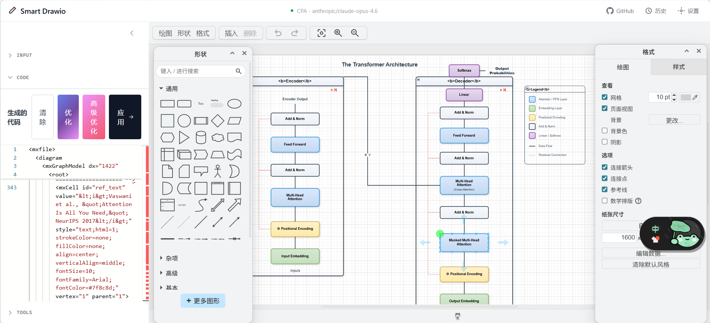
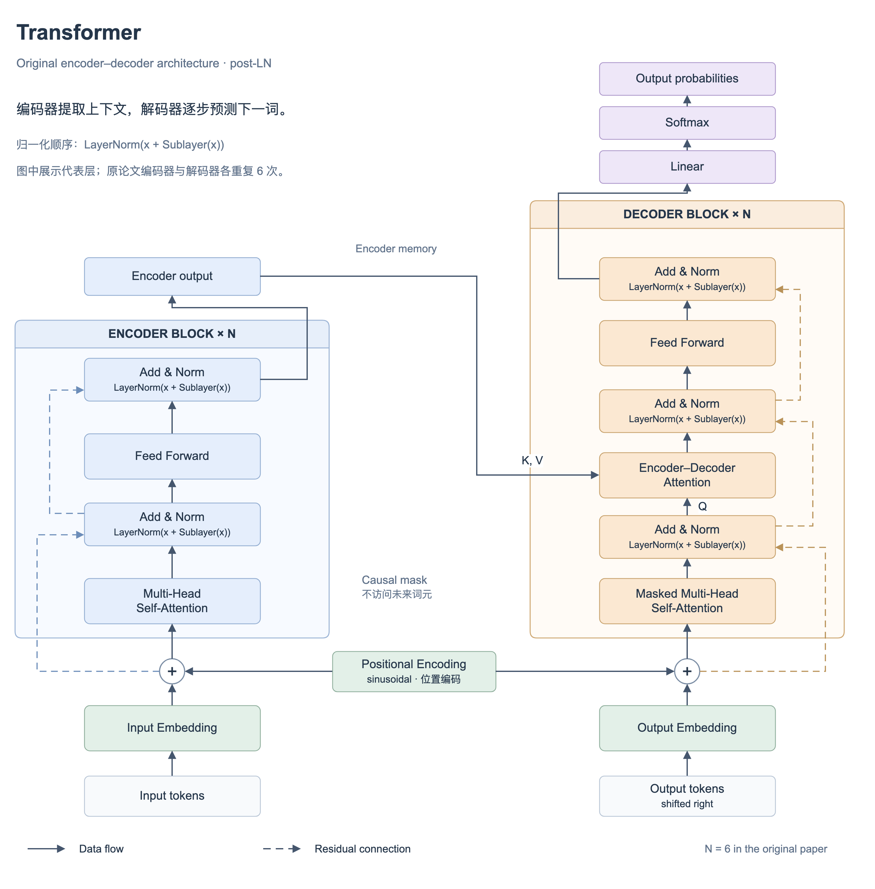
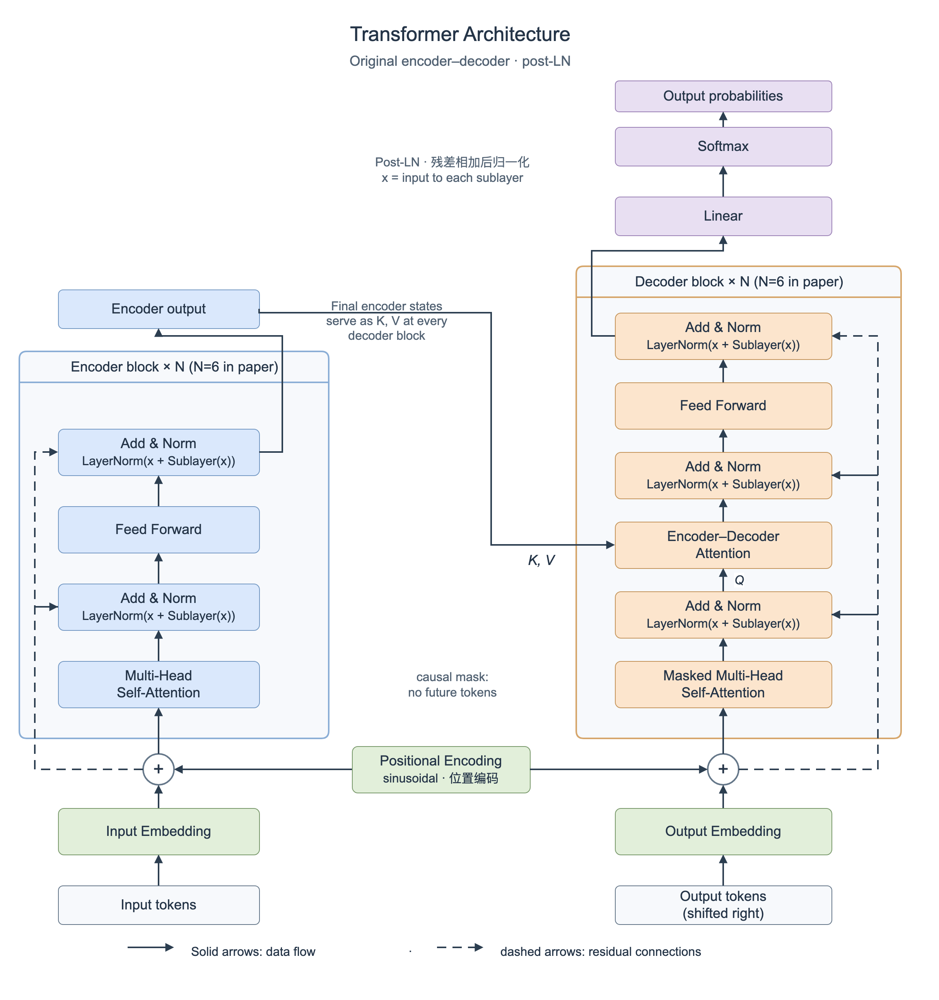

# Smart Drawio Next

[English](./README.md)

> 用自然语言或参考图片创建可编辑的 Draw.io 图表，适合科研、文档与演示场景。

**Skill 与 MCP 0.1.0 已发布：** [GitHub 版本](https://github.com/yunshenwuchuxun/smart-drawio-next/releases/tag/tools-v0.1.0) · [MCP npm 包](https://www.npmjs.com/package/@yunshenwuchuxun/smart-drawio-mcp) · [官方 MCP Registry](https://registry.modelcontextprotocol.io/v0.1/servers/io.github.yunshenwuchuxun%2Fsmart-drawio/versions/0.1.0)

## 在线体验

- 在线地址：<https://smart-drawio-next.vercel.app/>
- 说明：在线版本需要你自行提供 API Key

## 效果预览

| 首页 | Transformer |
|------|-------------|
|  |  |

| Swin-Transformer | CLIP |
|------------------|------|
|  |  |

### ProSST


## 项目简介

[smart-drawio-next](https://github.com/yunshenwuchuxun/smart-drawio-next) 是一个基于 Next.js 16、Draw.io embed 和流式 LLM 调用的图表生成工具，适合：

- 用自然语言快速生成流程图、架构图、时序图等结构化图表
- 上传参考图片，让 Vision 模型提取结构并转成可编辑内容
- 在 Monaco Editor 中直接修改 XML / JSON
- 将结果同步到内嵌 Draw.io 画布中继续可视化微调
- 使用高级优化面板统一布局、线条、样式和注释

项目内置多模型配置、工作区恢复、历史记录和通知系统，可直接部署为个人工具或团队内部服务。

## 核心能力

- **流式生成**：实时显示生成过程，长内容可继续生成，适合较长的科研图、架构图和多模块流程图
- **多模态输入**：支持文本描述和参考图片，既可以从零生成，也可以基于已有截图二次编辑
- **代码与画布双视图**：XML 编辑与 Draw.io 渲染同步联动，既适合可视化用户，也适合希望精细控制代码的用户
- **后处理工具链**：可批量优化结构、连线、文字和视觉风格，减少手工拖拽和样式调整
- **多配置管理**：支持 OpenAI / Anthropic 兼容接口，适合个人、多模型切换和内部部署场景
- **本地历史记录**：最近 20 条生成结果可回放，方便对比不同提示词和版本效果
- **适合科研与技术表达**：相较于纯图片生成，更适合输出可编辑、可复用、可继续维护的结构化图表

## Skill 与 MCP

**0.1.0 已公开发布**，可按使用方式选择入口：

| 入口 | 功能 | 分发位置 | 模型配置 |
| --- | --- | --- | --- |
| 网页应用 | 从文本或图片生成图表，在内嵌 Draw.io 中编辑 | [在线应用](https://smart-drawio-next.vercel.app/)或自行部署 Next.js | 在浏览器配置提供商 |
| `smart-drawio` Skill | 指导助手创建、修改、校验并保存可编辑图表 | [GitHub Skill](skills/smart-drawio)和[版本 ZIP](https://github.com/yunshenwuchuxun/smart-drawio-next/releases/download/tools-v0.1.0/smart-drawio-skill-0.1.0.zip) | 使用当前助手自身模型 |
| Smart Drawio MCP | 通过本地 stdio 工具生成、校验、修复和美化 XML | [npm 包](https://www.npmjs.com/package/@yunshenwuchuxun/smart-drawio-mcp)和[Registry 登记](https://registry.modelcontextprotocol.io/v0.1/servers/io.github.yunshenwuchuxun%2Fsmart-drawio/versions/0.1.0) | 仅 `generate_drawio` 需要模型 API |

### 安装 Skill

安装固定发布版本：

```sh
npx skills add https://github.com/yunshenwuchuxun/smart-drawio-next/tree/tools-v0.1.0/skills/smart-drawio
```

Skill 以 GitHub 文件包分发，没有独立 npm 包。命令中的 `npx skills` 运行通用 [Skills CLI 安装器](https://github.com/vercel-labs/skills)，实际从仓库下载 Skill。随包 Python 3 脚本可离线校验，不依赖第三方 Python 包；MCP 是可选增强。

调用示例：

> `$smart-drawio` 画一张原始编码器—解码器 Transformer 架构图，保存为 transformer.drawio，并检查连线和文字布局。

### 配置 MCP

需要 Node.js 20.9 或更高版本，以及支持本地 stdio MCP 的客户端。采用 `mcpServers` JSON 配置的客户端可填写：

```json
{
  "mcpServers": {
    "smart-drawio": {
      "command": "npx",
      "args": ["-y", "@yunshenwuchuxun/smart-drawio-mcp@0.1.0"]
    }
  }
}
```

客户端负责启动进程并通过 stdin/stdout 通信。使用生成工具时，在 MCP 进程环境中配置 `SMART_DRAWIO_PROVIDER`、`SMART_DRAWIO_BASE_URL`、`SMART_DRAWIO_API_KEY` 和 `SMART_DRAWIO_MODEL`，连接自己的 OpenAI / Anthropic 兼容接口。

| 工具 | 功能 | 是否需要模型 API |
| --- | --- | --- |
| `generate_drawio` | 根据文本生成完整且通过校验的 XML | 是 |
| `validate_drawio` | 检查 XML 语法、ID、父节点及引用 | 否 |
| `repair_drawio` | 保守修复支持的缺失闭合标签 | 否 |
| `style_drawio` | 应用主题、风格套装、预设和绘图技巧 | 否 |
| `list_drawio_options` | 查询支持的图表类型、主题和工具选项 | 否 |

MCP 返回未压缩 XML，由客户端保存文件。PNG / SVG / PDF 预览或导出需要可用的 Draw.io 渲染器或编辑器。0.1.0 提供本地 stdio 工具；Registry 链接是安装元数据，Vercel 地址是网页入口。当前包没有远程 HTTP MCP 地址或实时画布会话控制。

### 实际生成示例

下图均通过官方 Draw.io 查看器真实渲染，并提供可编辑源文件：

| Skill 工作流 | MCP 生成工作流 |
| --- | --- |
|  |  |
| [可编辑 .drawio](https://github.com/yunshenwuchuxun/smart-drawio-next/releases/download/tools-v0.1.0/transformer-skill.drawio) | [可编辑 .drawio](https://github.com/yunshenwuchuxun/smart-drawio-next/releases/download/tools-v0.1.0/transformer-mcp.drawio) |

Skill 示例使用助手自身模型生成；MCP 示例通过真实 OpenAI 兼容 API 请求 `codex/gpt-6.1-sol`，再进行 MCP 校验和 Draw.io 渲染。MCP 原始输出有一处说明文字被连线穿过，示例保留实际生成效果。

[发布版本 CI](https://github.com/yunshenwuchuxun/smart-drawio-next/actions/runs/38578657214) 已通过 291 个 JavaScript 测试、11 个 Python 测试、8 个浏览器测试，以及 lint、生产构建和独立包安装验证。公开 Skill 安装及 npm MCP 的握手和工具调用也已验证。

详见 [MCP 配置](packages/mcp/README.md)、[Skill 安装](docs/skill-installation.md)和[版本下载](https://github.com/yunshenwuchuxun/smart-drawio-next/releases/tag/tools-v0.1.0)。网页仍可独立部署到 Vercel。

## 支持的图表类型

支持 20+ 种图表类型，可手动指定，也可让模型自动判断：

- 流程图
- 思维导图
- 组织架构图
- 时序图
- UML 类图
- ER 图
- 甘特图
- 时间线
- 树形图
- 网络拓扑图
- 架构图
- 数据流图
- 状态图
- 泳道图
- 概念图
- 鱼骨图
- SWOT 分析图
- 金字塔图
- 漏斗图
- 维恩图
- 矩阵图
- 信息图

## 内置主题

内置 10 套主题配色：

- 科研（Research）
- 商务（Business）
- 暖色（Warm）
- 冷色（Cool）
- 暗色（Dark）
- 高对比（Contrast）
- 马卡龙（Pastel）
- 森林（Forest）
- 紫罗兰（Violet）
- 中性（Neutral）

## 工具系统

生成后可以在侧边栏的“工具”面板中继续处理图表。所有操作基于 XML 变换，即时生效，并可继续迭代。

### 1. 绘图技巧

用于批量优化结构与连线：

- **网格对齐**：坐标吸附到 10px 网格
- **正交路由**：连线转为直角折线
- **曲线连线**：连线转为平滑曲线
- **标签背景**：给连线标签添加白底
- **统一间距**：调整同层元素的水平间距
- **交叉跳跃**：交叉连线显示跳跃弧线
- **圆角连线**：让拐角更柔和
- **统一箭头**：统一终点箭头样式
- **清除拐点**：删除手动 waypoint，交给自动路由

### 2. 样式预设

用于叠加局部视觉效果：

- 阴影效果
- 渐变填充
- 圆角样式
- 玻璃效果
- 手绘风格
- 漫画风格
- 虚线描边
- 透明填充
- 粗线描边
- 无边框
- 等宽圆角
- 交叉填充
- 点状填充
- 锯齿填充
- 半透明
- 描边渐隐
- 固定虚线
- 空心箭头

### 3. 风格套装

用于一键应用完整视觉风格：

- **科研清爽**：规整、克制，适合论文插图
- **演示卡片**：圆角、阴影、曲线，适合汇报展示
- **商务简约**：正式商务风格
- **扁平极简**：去装饰的现代扁平风
- **线框草图**：适合讨论布局和信息层级
- **漫画白板**：轻松、非正式讨论风格
- **水彩手绘**：更具草图感和艺术感
- **极简线条**：只保留轮廓和文本
- **便签卡片**：便签式卡片视觉
- **蓝图技术**：适合工程图、技术图纸

### 4. 文本工具

用于统一文字排版：

- 自动换行
- 文本居中
- 文本衬底
- 文本加粗
- 缩小字号
- 文本间距

## 工具系统示例

| 基线图：未应用额外样式 | 样式预设：漫画风格 + 交叉填充 |
|------------------------|------------------------------|
|  |  |

| 风格套装：蓝图技术 | 风格套装：商务简约 |
|--------------------|--------------------|
|  |  |

## 界面结构

1. **输入区（Chat + ImageUpload）**
   - 输入自然语言描述
   - 上传参考图片
   - 支持停止生成、继续生成、错误提示

2. **代码区（CodeEditor）**
   - 查看和编辑 XML / JSON
   - 执行清空、优化、高级优化、应用等操作

3. **画布区（DrawioCanvas）**
   - 渲染生成结果
   - 在 Draw.io 中继续可视化调整

4. **辅助弹窗**
   - `ConfigManager`
   - `HistoryModal`
   - `OptimizationPanel`
   - 其他辅助面板

## 工具开发

网页与工具复用绘图核心。从源码构建和验证发布包：

```bash
pnpm build:mcp
pnpm test:tools
pnpm test:skill
pnpm verify:mcp
pnpm pack:tools
```

发布检查见[打包发布](./docs/publishing.md)。仅发布 `packages/mcp`，网站根包继续保持 private。

## 技术栈

- **框架**：Next.js 16 (App Router) + React 19
- **画布**：Draw.io embed
- **编辑器**：`@monaco-editor/react`
- **样式**：Tailwind CSS v4
- **LLM 接入**：OpenAI / Anthropic 兼容接口 + SSE 流式响应
- **状态持久化**：localStorage

## 快速开始

### 环境要求

- Node.js >= 20.9（推荐 Node.js 24 LTS）
- pnpm >= 8
- 可用的 OpenAI / Anthropic 兼容 API Key

### 安装与启动

```bash
git clone https://github.com/yunshenwuchuxun/smart-drawio-next.git
cd smart-drawio-next
pnpm install
pnpm dev
```

启动后访问：<http://localhost:3000>

### 常用命令

| 命令 | 说明 |
|------|------|
| `pnpm dev` | 启动开发环境 |
| `pnpm build` | 生产构建 |
| `pnpm start` | 启动生产服务 |
| `pnpm lint` | 运行 ESLint |
| `pnpm test -- run` | 运行单元测试 |

## Docker 部署

### 前提条件

- Docker >= 20.10
- Docker Compose V2

### 快速启动

```bash
docker compose up -d --build
```

启动后访问：<http://localhost:3000>

镜像使用多阶段构建和 Next.js standalone 输出，适合直接部署。

### 模型配置

在网页设置中配置提供商、Base URL、API Key 和模型。当前版本按请求使用用户配置，尚未实现 `ACCESS_PASSWORD` 或 `SERVER_LLM_*` 服务端托管配置。

### 代理与本地模型

如果 Docker 需要代理或访问宿主机上的本地模型：

```bash
cp docker-compose.override.example.yml docker-compose.override.yml
```

然后按机器环境修改，再重新启动：

```bash
docker compose up -d --build
```

常见场景：

- 使用宿主机代理访问外网 API
- 访问宿主机上的 Ollama / LM Studio
- 挂载自定义 CA 证书以通过企业代理

### 常用 Docker 命令

```bash
docker compose logs -f app
docker compose down
docker compose up -d --build
docker compose ps
```

## 模型推荐

项目支持 OpenAI / Anthropic 兼容接口，使用提供商实际开放的模型 ID。文本绘图需要稳定的结构化输出能力，参考图片生成需要模型支持图片输入。

0.1.0 已通过兼容网关请求 `codex/gpt-6.1-sol` 生成 Transformer 架构图；这是一次具体场景的验证结果。复杂图表可能耗时数分钟，实际效果和速度取决于模型、提示词与提供商配置。

## LLM 配置

### 前端多配置模式

默认情况下，用户可以在前端自己配置：

- 提供商（OpenAI / Anthropic / 兼容接口）
- Base URL
- API Key
- Model

保存的配置持久化在浏览器 localStorage 中。生成时，当前模型配置和输入会发送到应用的 API 路由，再由服务端调用选定的模型提供商。

### 工作区恢复与请求限制

画布、未应用的代码草稿、文本输入、主题和预设会在变化后自动保存到本地，并在刷新时恢复。页头会显示保存状态。工作区快照不包含模型凭证或图片数据；刷新后需要重新上传图片。

生成请求上限为 4 MiB，图片上限为 2 MiB，为 Vercel 上的 base64 编码预留空间。模型调用总超时为 240 秒、空闲超时为 60 秒。停止生成会取消上游模型请求，以及待执行的续写和重试。

XML 在浏览器和 Node.js 中采用同一校验规则，逐页检查语法、重复 ID、父节点循环和悬空引用。本阶段支持未压缩页面，压缩 `.drawio` 页面会明确报错。截断输出保留在编辑器；用户显式应用时可修复闭合标签，丢弃不完整尾部时会提示。

兼容的 JSON 输入遇到未知或不合法元素时会报错，并保留原图与草稿。显式应用空数组 `[]` 表示创建空图，仍可撤销恢复。

## 常见问题

### API Key 会发送到哪里？

保存的配置位于本地浏览器。每次生成会将当前配置（包含 API Key）发送到应用服务端，服务端用该密钥向你选定的模型提供商认证。MCP 生成使用进程环境中配置的密钥；Skill 可以使用助手自身模型创建 XML，无需额外配置绘图生成 API。

### 生成内容被截断怎么办？

界面会自动提供“继续生成”按钮，继续请求剩余内容。

### 图片识别失败怎么办？

请使用支持 Vision 的模型，并确保图片格式与大小符合要求。

### 历史记录会不会越来越大？

不会。默认最多保留最近 20 条。

## 致谢与贡献

- 本项目基于 [smart-excalidraw-next](https://github.com/liujuntao123/smart-excalidraw-next) 演进而来
- 如果项目对你有帮助，欢迎：
  - 给仓库点一个 Star
  - 分享给更多需要的人

## 友链

- [linux.do](https://linux.do)

## License

MIT
